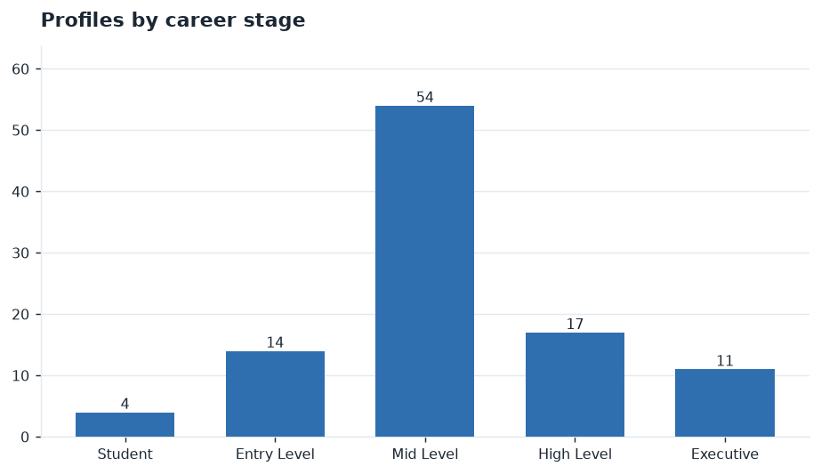
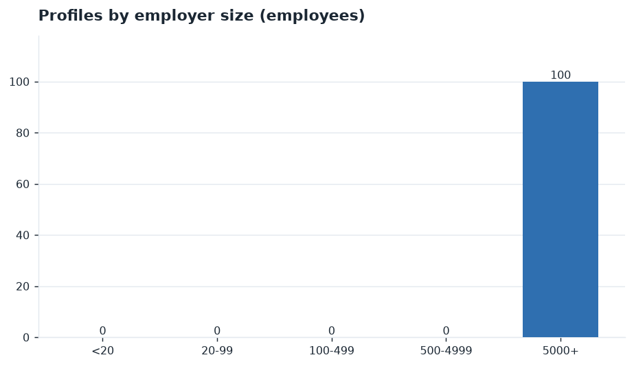
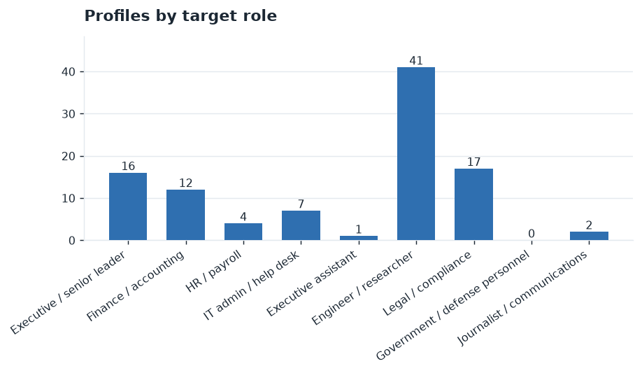
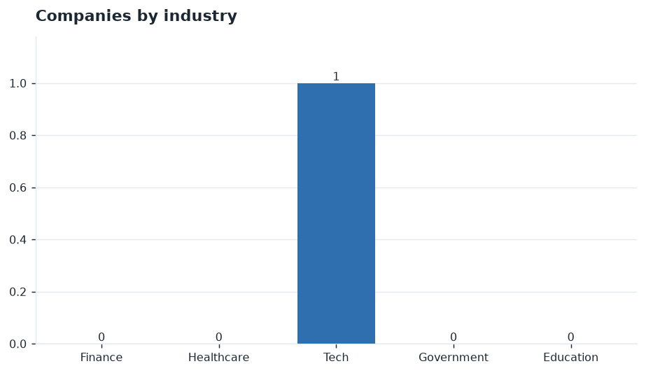
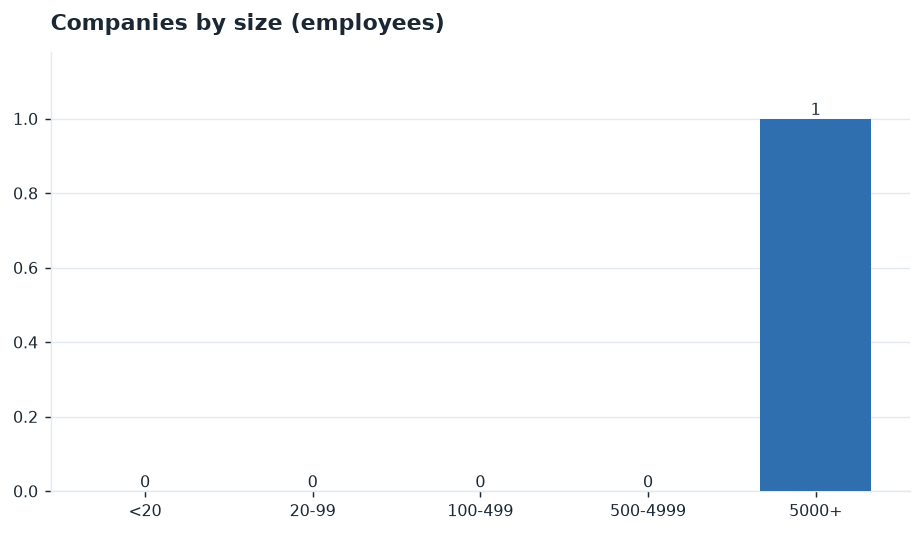
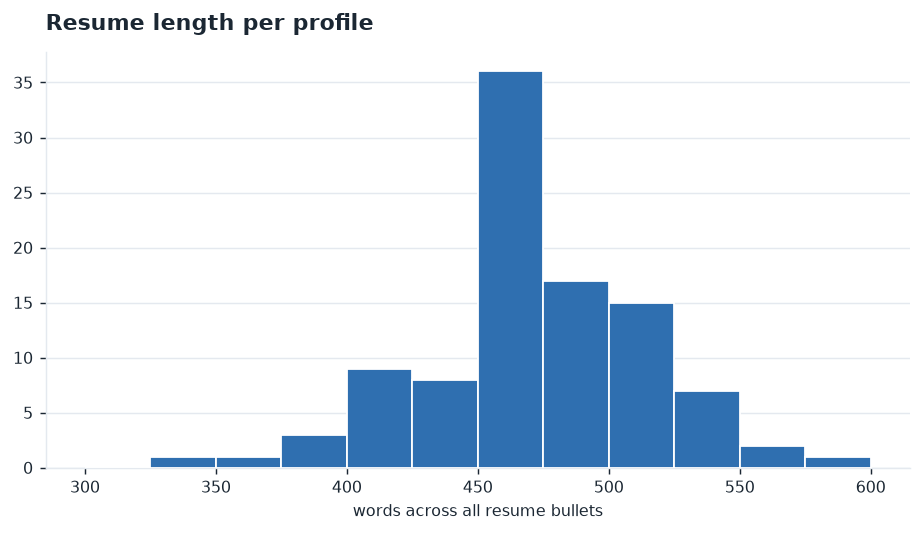

# Synthetic Spear-Phishing Corpus — v2 Run

_Generated 2026-11-07 · backend: **gemini** · model: `gemini-3.5-flash-lite` · population v2 · prompt v2.2 · random seed 21_

> All profiles, companies, and emails are **fictional**. Every email address and web domain is under a reserved `.example` zone. The corpus exists to train and evaluate a spear-phishing **detector**; nothing here is or can be sent.

## 1. Scope and method

1. **Sampler** (`src/population.py`): every person's industry, employer size, occupation, age, sex, education, school, tenure, career stage, prior employers, online presence, email workload and phishing susceptibility are drawn from the sourced distributions in `config/empirical.py`. The sampled population is checked against the sources in `validation.md`.
2. **Narrative** (`src/prompts_v2.py`, `src/profile_v2.py`): the model receives the fixed spec and writes only text: a resume of 450–550 words with current-job, prior-job and education sections in which every bullet carries a numeric performance metric, prior job titles, majors, social handles, posts, projects, private details, access, traits and response tendencies. Output that violates the spec or the resume rules is re-requested with the violations listed.
3. **Spear email** (`src/emails_v2.py`): the model receives the full merged profile and the employer and writes one spear email; the sender and every link must be under `.example`.

**Record files** (one SQLite table each in `spear.sqlite`, linked by `profile_id` / `org_id`):

| file | records |
| --- | --- |
| orgs.jsonl | 1 |
| profiles_core.jsonl | 100 |
| profiles_public.jsonl | 100 |
| profiles_private.jsonl | 100 |
| profiles_behavior.jsonl | 100 |
| emails_attack.jsonl | 0 |

| validation | count |
| --- | --- |
| profiles kept with narrative issues | 24 |
| emails kept with issues | 0 |

## 2. Who was generated

100 profiles across 1 synthetic companies.


*Profiles by industry*

| industry | count | share |
| --- | --- | --- |
| Finance | 0 | 0% |
| Healthcare | 0 | 0% |
| Tech | 100 | 100% |
| Government | 0 | 0% |
| Education | 0 | 0% |



*Profiles by career stage*

| career stage | count | share |
| --- | --- | --- |
| Student | 4 | 4% |
| Entry Level | 14 | 14% |
| Mid Level | 54 | 54% |
| High Level | 17 | 17% |
| Executive | 11 | 11% |



*Profiles by employer size*

| employees | count | share |
| --- | --- | --- |
| <20 | 0 | 0% |
| 20-99 | 0 | 0% |
| 100-499 | 0 | 0% |
| 500-4999 | 0 | 0% |
| 5000+ | 100 | 100% |



*Profiles by target role*

| target role | count | share |
| --- | --- | --- |
| Executive / senior leader | 16 | 16% |
| Finance / accounting | 12 | 12% |
| HR / payroll | 4 | 4% |
| IT admin / help desk | 7 | 7% |
| Executive assistant | 1 | 1% |
| Engineer / researcher | 41 | 41% |
| Legal / compliance | 17 | 17% |
| Government / defense personnel | 0 | 0% |
| Journalist / communications | 2 | 2% |

### Companies



*Companies by industry*



*Companies by size*

## 3. Resumes



*Resume length per profile*

| metric | value |
| --- | --- |
| profiles | 100 |
| words per resume (min / median / max) | 343 / 468 / 597 |
| resumes within 450–550 words | 76 / 100 |
| bullets with a numeric metric | 1630 / 1630 |
| distinct bullets | 1630 / 1630 |

## 4. Example profiles

**Robert Jefferson** — Counsel  
`robert.jefferson@lumatdigital.example` · Tech · Mid Level · target role: _Legal / compliance_ · Phoenix, AZ · age 72 · tenure 1.03 y

Resume (535 words):

- *Counsel (current)*
  - Advised senior executive leadership on 45 distinct corporate compliance matters utilizing specialized regulatory databases for Lumat Digital, successfully mitigating potential litigation exposure and reducing liability risk by 28 percent across the division.
  - Drafted and negotiated 112 commercial technology agreements in collaboration with internal sales teams using standardized enterprise contract software, accelerating standard deal closure velocity by 14 business days for key strategic software accounts.
  - Conducted comprehensive internal compliance audits covering 350 employees across multiple departments by deploying automated auditing frameworks, identifying regulatory gaps and successfully implementing corrective action plans that achieved 99 percent policy adherence.
- *Compliance Analyst, Quarry Health (1982–1990)*
  - Reviewed 210 healthcare provider contracts and associated regulatory filings using manual document verification methods for Quarry Health, successfully eliminating compliance discrepancies and reducing audit remediation cycle times by 18 percent over four years.
  - Facilitated internal compliance training sessions for 45 administrative staff members utilizing standardized educational presentations, improving departmental regulatory assessment scores from an initial baseline of 72 percent up to a final 94 percent proficiency rate.
  - Maintained accurate physical and digital document archives comprising 1500 confidential medical records through meticulous indexing protocols, achieving a 99 percent retrieval accuracy rating during external state regulatory inspections conducted annually.
- *Senior Staff Attorney, Elmhurst Services Bureau (1990–2004)*
  - Managed a comprehensive municipal litigation docket consisting of 85 active civil cases for Elmhurst Services Bureau using centralized legal management software, successfully reducing average case resolution duration by 60 days across all assigned dockets.
  - Prepared 140 formal legal opinions and advisory memoranda for municipal department heads using exhaustive statutory research methods, ensuring complete adherence to state administrative codes and avoiding legal challenges throughout a 14-year tenure.
  - Coordinated inter-agency legal disclosures involving 25 distinct public entities through secure communication channels, achieving a 100 percent on-time statutory compliance record for Freedom of Information Act requests over a full decade.
- *Managing Legal Counsel, Lumat Municipal Office (2004–2014)*
  - Supervised 12 junior legal analysts and paralegals within the Lumat Municipal Office using structured workflow distribution tools, improving overall document review output by 22 percent while maintaining flawless quality control standards.
  - Drafted 65 local zoning ordinances and administrative resolutions utilizing specialized legislative drafting software, securing unanimous municipal council approval on 95 percent of proposed texts during the first reading across five years.
- *Director of Legal Operations, Northbay Capital (2014–2017)*
  - Evaluated 90 venture capital investment proposals and associated term sheets for Northbay Capital using advanced financial modeling applications, safeguarding firm assets and contributing to a successful portfolio exit valuation increase of 15 percent.
  - Negotiated complex corporate governance structures for 18 portfolio startup companies utilizing standardized equity purchase agreements, minimizing post-closing shareholder disputes and achieving a 98 percent successful transaction execution rate.
- *General Counsel, Cairnwell Software (2017–2026)*
  - Directed corporate legal operations for 310 enterprise clients at Cairnwell Software using cloud-based contract management suites, accelerating annual software license renewals by 12 days and decreasing contract dispute escalation rates by 25 percent.
  - Resolved 550 complex intellectual property infringement claims and software licensing disputes utilizing specialized patent databases, recovering 4.2 million dollars in disputed licensing fees while preserving essential strategic enterprise partnerships.
- *Education*
  - Completed rigorous coursework in social science disciplines at University of California-Berkeley (Berkeley, CA) in 1976, maintaining a 3.6 cumulative grade point average and actively participating in 4 academic research symposiums.
  - Earned the Juris Doctor degree from Hofstra University (Hempstead, NY) in 1979, graduating in the top 15 percent of the class while serving as an editor for the law review publication.

- Public footprint: low
- Private projects: Undertook a comprehensive overhaul of legacy enterprise contract templates alongside Victoria Callahan, standardizing liability clauses across 120 distinct software distribution agreements to minimize corporate exposure., Mentored Cody Barillas through complex regulatory research procedures, supervising the drafting of 14 compliance memoranda concerning emerging cross-border data privacy standards.
- Sensitive access: Full administrative access to corporate legal document management repositories containing confidential enterprise litigation files and pending merger documentation., Authorization to approve outside counsel legal spend invoices up to 100000 dollars without requiring secondary executive sign-off., Access to proprietary board meeting minutes, executive compensation structures, and unpublished intellectual property filings.
- Behavior: security awareness medium, p(click) 0.265; traits: Methodical, Cautious, Detail-oriented

**Paul Jordan** — IT Support Lead  
`paul.jordan@lumatdigital.example` · Tech · Mid Level · target role: _IT admin / help desk_ · Phoenix, AZ · age 69 · tenure 18.08 y

Resume (466 words):

- *IT Support Lead (current)*
  - Managed 1450 workstations using Active Directory and automated patching tools for 44771 employees, reducing monthly endpoint vulnerability alerts by 42 percent across all local branches.
  - Resolved 230 complex tier three hardware and software help desk tickets each month, improving overall internal user satisfaction ratings from 82 percent up to 94 percent.
  - Engineered standardized OS deployment images using Microsoft Deployment Toolkit for 1200 new hires annually, cutting manual workstation setup duration from 180 down to 45 minutes.
  - Authored 35 step-by-step troubleshooting knowledge base articles for internal staff, resulting in a 28 percent drop in recurring tier one IT support call volume.
- *Junior Computer Operator, Oakbridge Services Bureau (1980–1984)*
  - Maintained 120 desktop terminals and connected peripheral devices for 85 clerical staff members, reducing average daily hardware downtime duration by 35 percent using systematic diagnostics.
  - Processed 45 daily batch data entry jobs on mainframe systems with zero critical transcription errors across 4 consecutive calendar quarters of operation.
  - Assisted senior technicians in upgrading local area network cabling infrastructure across 3 office floors supporting 90 active connections within a tight weekend schedule.
- *Desktop Support Specialist, Bellmont Partners (1984–1986)*
  - Configured 75 new microcomputer workstations with proprietary accounting software packages for 50 financial analysts, accelerating quarterly report generation speed by 22 percent.
  - Diagnosed and repaired 15 dot matrix and laser printers weekly using specialized maintenance kits to extend operating lifespans past 4 years of continuous service.
  - Conducted 12 bi-weekly software orientation sessions for incoming administrative personnel to ensure proper data security protocols were understood by all attendees.
- *Senior Help Desk Supervisor, Vireo Medical (1986–2001)*
  - Supervised a help desk team of 8 technicians supporting 600 medical staff users across 4 clinical departments, lowering average ticket resolution time from 4 hours to 45 minutes.
  - Deployed 300 encrypted laptop computers for traveling clinical representatives using ghost imaging software, achieving 100 percent compliance with patient data privacy standards.
  - Maintained inventory control databases tracking 1500 hardware assets valued at 2500000 dollars with an annual shrinkage rate below 0.5 percent.
  - Created 20 disaster recovery backup verification scripts executed nightly across 6 critical database servers to guarantee zero data loss during simulated power outages.
  - Coordinated with Nancy Henry on executing quarterly IT infrastructure upgrades across 5 regional clinics without exceeding the allocated 50000 dollar budget limit.
- *IT Systems Auditor, Whitcomb Analytics (2001–2002)*
  - Audited 250 corporate workstations for unauthorized software installations during a company-wide compliance review, reducing unlicensed application counts by 95 percent in 3 months.
  - Provided urgent hardware troubleshooting support to 120 financial analysts during peak tax season, maintaining 99.8 percent network uptime across all trading desks.
- *Lead Network Administrator, Corvane Networks (2002–2009)*
  - Administered Microsoft Exchange email systems supporting 850 corporate accounts, achieving a 99.99 percent message delivery success rate over 7 operational years.
  - Trained 14 junior IT support specialists on ticket escalation procedures and customer service best practices, improving team first-contact resolution rates from 60 to 85 percent.
- *Education*
  - Completed 128 credit hours in general studies coursework at University of Phoenix-Arizona (Phoenix, AZ) leading to graduation with a 3.4 grade point average.

- Public footprint: low
- Private projects: Upgrading legacy ticket routing systems to streamline support workflows for the Lumat Digital enterprise., Developing internal knowledge base documentation for remote workers to reduce repetitive password reset requests.
- Sensitive access: Active Directory domain administrator privileges for Lumat Digital internal networks, Master help desk ticketing system dashboard access with user credential reset capabilities, Local server room physical security badge access and master key inventory control
- Behavior: security awareness high, p(click) 0.078; traits: Extremely methodical, Deeply cautious, Routine-oriented, Patient teacher

**Jesus Alarcon** — HR Generalist  
`jesus.alarcon@lumatdigital.example` · Tech · Mid Level · target role: _HR / payroll_ · Phoenix, AZ · age 44 · tenure 6.96 y

Resume (461 words):

- *HR Generalist (current)*
  - Managed comprehensive human resources operations and employee relations support for over 1500 technology professionals at Lumat Digital using Workday, successfully reducing voluntary employee turnover by 4 percent over the course of last year.
  - Facilitated the annual benefits open enrollment cycle across 3 distinct regional offices utilizing BambooHR, achieving a remarkable 98 percent employee participation rate within the strict 3 week deadline established by leadership.
  - Facilitated 45 new hire orientation sessions for incoming engineering staff, utilizing internal learning management systems to drive a 95 percent positive satisfaction score on post onboarding survey responses.
  - Resolved 320 employee payroll discrepancies and benefits inquiries annually using ADP Workforce Now, maintaining an average case resolution time of less than 24 hours while ensuring full regulatory compliance.
  - Partnered with department directors to redesign internal performance review workflows for 600 staff members, increasing timely review submissions from 62 percent to 91 percent across the entire organizational division.
  - Coordinated 12 company wide diversity and inclusion workshops partnering with external consultants, boosting internal employee resource group membership counts by 35 percent throughout the vibrant Phoenix metropolitan headquarters.
- *HR Assistant, Thornfield Agency (2005–2008)*
  - Administered personnel records and onboarding documentation for 120 staff members at Thornfield Agency utilizing legacy filing systems, reducing filing errors by 15 percent during my tenure.
  - Processed biweekly payroll transactions and attendance tracking for 85 employees using proprietary software, achieving 99 percent accuracy across 36 consecutive monthly pay cycles without major audit findings.
  - Responded to 240 employee inquiries regarding health insurance and vacation policies annually, maintaining a customer satisfaction rating of 92 percent according to internal department feedback surveys.
- *Personnel Coordinator, Zephyr Capital (2008–2012)*
  - Supported recruitment pipelines for 45 open positions at Zephyr Capital using Taleo applicant tracking software, decreasing average time to hire from 45 days down to 32 days.
  - Conducted initial phone screenings for 300 prospective candidates annually across administrative and financial roles, forwarding 75 qualified finalists to hiring managers for second round interviews.
  - Maintained compliance records for employee background checks and reference verifications across 200 hires, achieving a 100 percent audit pass rate during annual corporate compliance reviews.
- *School District HR Specialist, Tamarack School District (2012–2019)*
  - Coordinated substitute teacher placement and attendance tracking across 12 schools in Tamarack School District, managing a daily roster of 150 staff members with a 98 percent fill rate.
  - Facilitated union grievance tracking and documentation for 400 district employees, reducing outstanding unresolved labor disputes by 20 percent over a period of 3 academic years.
- *Healthcare HR Coordinator, Tamarack Health (2019–2020)*
  - Managed credential verification and licensing renewals for 250 clinical staff members at Tamarack Health, ensuring zero compliance violations during state health department inspections.
  - Implemented a digital onboarding portal for 80 incoming medical personnel using local intranet tools, cutting administrative processing time per new hire by 35 percent.
- *Education*
  - Graduated from University of Minnesota-Twin Cities (Minneapolis, MN) with a Bachelor of Science in Business Administration, achieving a cumulative GPA of 3.4 while completing 120 credit hours.

- Public footprint: low
- Private projects: Maintains a weekend vintage furniture restoration workshop in a rented garage space in Tempe, selling refurbished mid century modern dressers and dining tables through local online marketplaces., Manages administrative logistics and bookkeeping for a small neighborhood community garden initiative involving 30 local families in the Phoenix area.
- Sensitive access: Employee personnel files and compensation records for Lumat Digital staff, Internal payroll processing systems and banking routing information, Employee benefits enrollment data and medical leave documentation
- Behavior: security awareness medium, p(click) 0.278; traits: Detail oriented, Approachable, Methodical

## 5. Example spear emails

No emails were generated in this run.

## Appendix — reproducing

```bash
python scripts/run_v2.py --profiles 100 --emails 0 --backend gemini --seed 21 --out data/v2/gemini100
```
