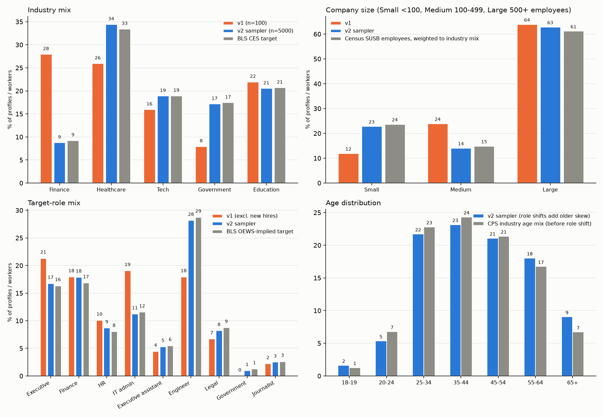

# Audit of the original 100 profiles (v1)

_Computed by `scripts/make_calibration_report.py` from `data/v1/*.jsonl`. Findings only._

## 1. How they were produced

- `report/REPORT.md` records `backend: LocalBackend`. The 100 profiles and 100 emails were **composed offline from fixed template pools** (`src/pools.py`), not written by an LLM. The `claude-sonnet-5-5` / `claude-haiku-5-5` labels in the report header are configuration metadata; the 5 'seed' items were also template-composed.
- Every sampling weight in `config/dimensions.py` is a hand-set number with an inline rationale (for example Finance 0.26, Tech 0.24, Healthcare 0.20, Government 0.16, Education 0.14). None is sourced.

## 2. Distribution vs government data

| Quantity | v1 | target | TV distance | chi-square p |
|---|---|---|---|---|
| Industry mix | Finance 28%, Healthcare 26%, Tech 16%, Government 8%, Education 22% | Finance 9%, Healthcare 33%, Tech 19%, Government 17%, Education 21% (BLS CES) | 0.20 | 0.0000 |
| Role mix (89 profiles, new hires excluded) | see figure | OEWS-implied | 0.16 | 0.1694 |
| Company size, share of profiles | Small 12%, Medium 24%, Large 64% | Small 24%, Medium 15%, Large 61% (SUSB employees, industry-weighted; Government row assumed) | 0.12 | 0.0033 |

Notes: v1 draws company size with weights 34% / 36% / 30% (Small / Medium / Large) and then allocates profiles to companies with `SIZE_ALLOC_WEIGHT` (1.0 / 2.4 / 4.2), which moves the share of profiles in Large companies to 64%. Government is 8% of v1 profiles (one company) against a 16% intended weight.

## 3. Traits that are functions of one other field

- **Security awareness is a lookup on career stage** (`STAGE_SECURITY` in `src/llm.py`): Entry Level -> low: 28; Executive -> high: 14; High Level -> medium: 25; Mid Level -> medium: 26; Student -> low: 7. No profile deviates.
- **Busy level:** Entry Level/high: 17; Entry Level/medium: 11; Executive/high: 14; High Level/high: 25; Mid Level/high: 8; Mid Level/medium: 18; Student/low: 7. Student is always low; High Level and Executive are always high.
- **Footprint:** Entry Level/low: 15; Entry Level/medium: 13; Executive/high: 14; High Level/high: 25; Mid Level/low: 13; Mid Level/medium: 13; Student/low: 4; Student/medium: 3. High Level and Executive are always high.
- Because each trait is determined by stage, the dataset contains no information in security awareness or busyness beyond career stage, and the 'low / medium / high' cut points are the arbitrary boundaries the advisor questioned.

## 4. Internal inconsistencies

- **Reporting line contradicts colleague list:** 76 of 100 profiles say 'Reports into X' where X is listed as something other than their manager.
- **Executive titles built by prefixing 'Chief':** 7 of 14 executives hold titles such as Chief Counsel, Chief Engineer, Chief HR Generalist, Chief Systems Administrator.
- **Students with workplace history and access:** 6 of 7 students have a 'year at <company>' post; 7 of 7 hold sensitive access.
- **Duplicate companies:** 2 domains are shared by two different org_ids (lumatlabs.example, vireohealth.example), so email addresses can collide.
- **Company-name pool:** 5 prefixes x 5 suffixes per industry (25 combinations) for 24 companies.

## 5. Variety

- Distinct first names 38, last names 30 across 100 people.
- Resume bullets: 42 distinct of 300. Distinct titles: 30. Distinct work locations: 15 (always the company HQ).
- Every social handle follows one pattern (first name + first three letters of last name): True.
- Education appears in 0 of 300 resume bullets; no profile names a school.
- Platform choice ignores role: GitHub accounts appear on Executive / senior leader (4), Engineer / researcher (valuable data) (5), HR / payroll (5), Legal / compliance (2), Finance / accounting (2), Executive assistant (2), IT admin / help desk (5), New hire (3).
- Email personalization fields are only 'target_role' and 'projects' in all 100 emails; colleague names appear in 6 of 100 email bodies.

## 6. What the audit does not cover
- Email text quality was not assessed beyond the personalization counts above.
