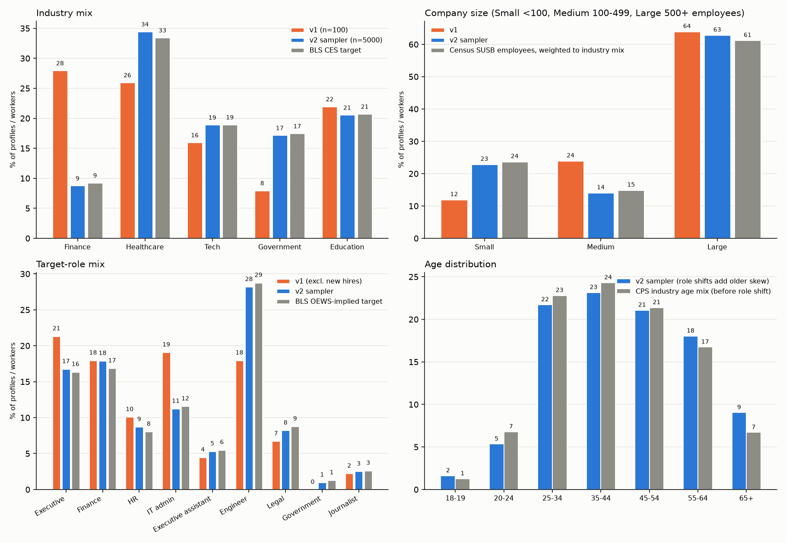

# Calibration of the synthetic profile generator to government and research data

_Generated by `scripts/make_calibration_report.py`. Research date: 2026-11-01. Findings only._

## 1. Summary

- The sampler in `src/population.py` now draws every profile's industry, firm size, occupation, age, sex, education, school, tenure, career stage, online-platform use, email workload and phishing susceptibility from distributions in `config/empirical.py`. Each parameter names a source in `config/sources.py` and an evidence grade (data / derived / proxy / assumption; Section 6).
- The LLM chooses none of the sampled quantities. It receives the sampled person and writes only text (resume, post text, projects, ground-truth details, traits). Since prompt v2.1 the resume is 450-550 words and every bullet must carry a numeric performance metric; those metrics are written by the model and are not calibrated to any source. Colleague names and prior employers are also sampled in code, because the live test showed the model reusing the same few names and employers across profiles.
- Statistical alignment is checked in `src/validate.py` on 5000 sampled people (Section 5) and on 1,000 (`data/v2/spec1000/validation.md`).
- A live Gemini run produced 15 new profiles with 0 narrative-validation failures after retries (Section 7).

## 2. The three advisor questions

### 2.1 Online presence as numbers

Each profile now carries numeric fields instead of a hand-drawn low/medium/high:

| Field | Source and grade |
|---|---|
| Platform membership (LinkedIn, X, Facebook, Instagram) | Pew 2026 by age and education, combined as an additive logit; data (overall LinkedIn 33% and X 25% cells were flagged by the fetch tool as inferred) |
| LinkedIn for executives at 500+ firms = 71.5% | 73% of Fortune 500 CEOs on any platform x 98% of those on LinkedIn; secondary, consultancy sample |
| GitHub, ResearchGate | no representative rate found; academics 39% (range 37-78% in three studies); GitHub rates are assumptions |
| Public posts per month, per platform | ~1.4% of LinkedIn users post weekly (weak lineage); occasional-poster share (18%) and role multipliers (journalists x6, executives x2.5) are assumptions |
| Email checks per day: median 77 (about 17 per computer-hour) | Mark et al. 2016, n = 40; data. Spread is an assumption |
| Emails received per day: mean 117 | Microsoft Work Trend Index 2025; data. Role factors (executives, assistants x1.25) are assumptions |
| In inbox late at night (by 10 pm): 29% | Microsoft Work Trend Index 2025; data |
| `footprint_score` = platforms + log2(1 + posts/month) + website | our definition; `footprint_level` cut points (1.5, 3.0) are still arbitrary and are labels only |

Not found: LinkedIn use or posting frequency by occupation or seniority; email-checking rates by role. The advisor's example (marketing staff are more active than others) therefore rests on assumed multipliers, not data. Given the sources, most sampled people have no or few public posts, which matches the 1.4% weekly-poster figure.

### 2.2 Company size

US Census SUSB 2022 (`susb22`), all industries:

| Enterprise size | % of firms | % of employees |
|---|---|---|
| < 20 | 89.44% | 16.2% |
| 20-99 | 8.77% | 16.2% |
| 100-499 | 1.46% | 13.5% |
| 500-4,999 | 0.29% | 17.8% |
| 5,000+ | 0.04% | 36.3% |

- By firm count, 98.2% of firms have fewer than 100 employees and only 1.46% have 100-499. By employment, 54% of employees work at firms of 500 or more and 36% at firms of 5,000 or more.
- The statement 'most companies are mid-sized and huge companies are rare' does not match these numbers under either measure: small firms dominate the count, and large firms (500+) employ the majority of people. 'Large companies are rare' holds only by firm count.
- The sampler draws the firm-size class of a person in proportion to employment in that class, per industry, because a profile is a person. Government is not in SUSB; its size classes are an assumption.

### 2.3 Role taxonomy and citations

See `report/BIBLIOGRAPHY.md`. Verified support exists for finance/BEC, journalists/activists, and (vendor, secondary) executives, IT staff and new hires. No source was found for HR/payroll, executive assistants, engineers/researchers or legal staff as targeted groups, and the origin of the list in `Profiles.md` could not be established. Role frequencies in the sampler come from BLS OEWS employment, not from how often a role is targeted. Two changes to the taxonomy: 'New hire' is now a tenure flag (tenure <= 90 days) rather than an occupation, and 'Government / defense personnel' uses federal protective-service employment as a proxy because OEWS excludes military.

## 3. What the sampler draws, in order

industry (BLS CES employment) -> firm-size class (SUSB, employee-weighted) -> organization (new or reused within industry and class) -> role (BLS OEWS employment, May 2023 industry tables) -> sub-occupation (lawyer / paralegal / compliance, etc.) -> age (CPS industry age bands, shifted by role median age) -> sex (CPS by role) -> surname group (CPS race/ethnicity by role; group not stored) -> names (Census 2010 surnames, SSA given names by birth decade) -> education level (BLS EP Table 5.3 for the sub-occupation, restricted to ages that can hold the degree) -> field (assumed by role) -> school (IPEDS completions at that level and field) -> tenure (BLS median by age, exponential, capped at career length) -> career stage (experience and OEWS manager share) -> title -> online presence -> work rhythm -> phishing susceptibility.

Phishing susceptibility: baseline phish-prone % by industry and org size (KnowBe4, undated edition, 20.8-31% by cell), x0.80 if the person received training (assumed effect; training share by org size from the UK CSBS 2025, a proxy), x1.44 for new hires (Keepnet vendor study). Person-level spread is a Beta distribution with concentration 16.1, solved from Lain et al. (2022): a mean per-email click rate of 5.67% with that spread gives 32.1% of people clicking at least once in 8 emails (observed 32.1%) and predicts 30.4% of clickers clicking 2+ times (observed 30.6%).

## 4. Added profile detail

`core`: age, gender, birth year, tenure, years of experience, new-hire flag, highest education, firm-size class. `public`: education records (level, major, institution, city/state, graduation year), career history (prior titles, invented employers, contiguous years), per-platform posting rates, footprint score. `behavior`: click probability, training flag, emails received and checked per day, late-night inbox flag. Two free-text detail themes (hobby, hometown, volunteer work, and similar) are sampled per person to vary the private details; the theme list has no statistics behind it.

## 5. Statistical alignment

How to read the tables: **implementation checks** are quantities drawn directly from a source distribution, so agreement is expected by construction and a failure would indicate a bug. **Held-out checks** compare quantities the sampler does not draw directly against source statistics it was not fit to.

### Sampler run, n = 5000

### Implementation checks (marginals drawn directly from the sources)

| Quantity | n | TV distance | chi-square p |
|---|---|---|---|
| Industry mix (BLS CES) | 5000 | 0.01 | 0.543 |
| Firm-size class, Finance (Census SUSB, employee-weighted) | 440 | 0.0692 | 0.057 |
| Firm-size class, Healthcare (Census SUSB, employee-weighted) | 1724 | 0.0075 | 0.929 |
| Firm-size class, Tech (Census SUSB, employee-weighted) | 947 | 0.0238 | 0.52 |
| Firm-size class, Government (Census SUSB, employee-weighted) [assumed targets] | 860 | 0.0365 | 0.157 |
| Firm-size class, Education (Census SUSB, employee-weighted) | 1029 | 0.0477 | 0.007 |
| Role mix, Finance (BLS OEWS) | 440 | 0.0431 | 0.74 |
| Role mix, Healthcare (BLS OEWS) | 1724 | 0.0258 | 0.252 |
| Role mix, Tech (BLS OEWS) | 947 | 0.0221 | 0.786 |
| Role mix, Government (BLS OEWS) | 860 | 0.0406 | 0.363 |
| Role mix, Education (BLS OEWS) | 1029 | 0.0381 | 0.372 |

**Sex by role** (observed share of women vs CPS target; z = binomial z-score)

| Role | n | observed | target | z |
|---|---|---|---|---|
| Executive / senior leader | 839 | 0.398 | 0.418 | -1.17 |
| Finance / accounting | 896 | 0.679 | 0.689 | -0.67 |
| HR / payroll | 436 | 0.823 | 0.783 | 2.05 |
| IT admin / help desk | 563 | 0.297 | 0.271 | 1.38 |
| Executive assistant | 267 | 0.948 | 0.935 | 0.83 |
| Engineer / researcher | 1410 | 0.201 | 0.203 | -0.15 |
| Legal / compliance | 412 | 0.566 | 0.543 | 0.9 |
| Government / defense personnel | 50 | 0.44 | 0.471 | -0.44 |
| Journalist / communications | 127 | 0.37 | 0.411 | -0.94 |

**Highest education by role** (age 26+; BLS EP 5.3 target)

| Role | n | TV distance | chi-square p |
|---|---|---|---|
| Executive / senior leader | 804 | 0.0093 | 0.974 |
| Finance / accounting | 873 | 0.0265 | 0.594 |
| HR / payroll | 393 | 0.0439 | 0.197 |
| IT admin / help desk | 506 | 0.0582 | 0.033 |
| Executive assistant | 262 | 0.0607 | 0.227 |
| Engineer / researcher | 1163 | 0.0208 | 0.776 |
| Legal / compliance | 392 | 0.0353 | 0.901 |
| Government / defense personnel | 50 | 0.099 | 0.62 |
| Journalist / communications | 113 | 0.0803 | 0.083 |

### Held-out checks (not fit directly)

| Quantity | observed | target | note |
|---|---|---|---|
| Median tenure, age 25+ (BLS Jan 2026: 4.9 yrs) | 5.27 | 4.9 | Sampler uses medians by age band only; the overall median is not fit. |
| Median tenure, all (BLS: 4.1 yrs) | 4.66 | 4.1 | Prime-target occupations skew older than all workers; Students cap tenure at 2 yrs. |
| Median tenure, age 18-19 | 1.77 | 1.5 | n=81; tenure capped at time in labor force |
| Median tenure, age 20-24 | 1.0 | 1.5 | n=267; tenure capped at time in labor force |
| Median tenure, age 25-34 | 2.54 | 3.0 | n=1086; tenure capped at time in labor force |
| Median tenure, age 35-44 | 4.54 | 4.7 | n=1158; tenure capped at time in labor force |
| Median tenure, age 45-54 | 7.1 | 7.0 | n=1054; tenure capped at time in labor force |
| Median tenure, age 55-64 | 9.48 | 9.6 | n=902; tenure capped at time in labor force |
| Median tenure, age 65-99 | 10.65 | 9.9 | n=452; tenure capped at time in labor force |
| Median age, Executive / senior leader (CPS 11b) | 47.0 | 46.1 | n=839; role medians are cross-industry |
| Median age, Finance / accounting (CPS 11b) | 47.5 | 46.8 | n=896; role medians are cross-industry |
| Median age, HR / payroll (CPS 11b) | 42.0 | 42.0 | n=436; role medians are cross-industry |
| Median age, IT admin / help desk (CPS 11b) | 43.0 | 42.6 | n=563; role medians are cross-industry |
| Median age, Executive assistant (CPS 11b) | 49.0 | 47.6 | n=267; role medians are cross-industry |
| Median age, Engineer / researcher (CPS 11b) | 38.5 | 38.6 | n=1410; role medians are cross-industry |
| Median age, Legal / compliance (CPS 11b) | 46.0 | 45.8 | n=412; role medians are cross-industry |
| Median age, Journalist / communications (CPS 11b) | 41.0 | 41.4 | n=127; role medians are cross-industry |
| Median age, all sampled (CPS all-employed: 42.1) | 44.0 | 42.1 | Roles skew older than all workers |
| LinkedIn use, college graduates (Pew 2026: 51%) | 0.519 | 0.51 | n=3160; our sample skews 30-55, Pew averages all adults |
| LinkedIn use, HS or less (Pew 2026: 13%) | 0.162 | 0.13 | n=402; age 25+, excluding the 500+-firm executive override |
| Mean simulated-phish click probability (KnowBe4: ~27% avg, 2025 baseline 33.1%) | 0.233 | 0.27-0.33 | Inputs: industry x size baseline, training factor, new-hire factor |
| Mean baseline phish-prone % before training factor (KnowBe4 older edition avg ~27%) | 0.265 | 0.27 | Industry x size matrix weighted by this sample's mix |
| Share of new hires (tenure <= 90 days) | 0.046 | derived | Implied by exponential tenure model; no direct benchmark |
| Median email checks per day (Mark 2016: 77) | 76.7 | 77.0 |  |
| Mean emails received per day (Microsoft 2025: 117) | 125.3 | 117.0 | Role factors raise it slightly |
| Share in inbox by 10 pm (Microsoft 2025: 29%) | 0.281 | 0.29 |  |

### Distributions of derived labels (no benchmark)

- **career_stage**: {'Mid Level': 3023, 'Entry Level': 313, 'High Level': 793, 'Executive': 654, 'Student': 217}
- **security_awareness**: {'low': 769, 'medium': 2975, 'high': 1256}
- **busy_level**: {'medium': 2722, 'low': 927, 'high': 1351}
- **footprint_level**: {'high': 2030, 'medium': 1730, 'low': 1240}
- **company_size**: {'Small': 1147, 'Large': 3146, 'Medium': 707}
- **gender**: {'man': 2693, 'woman': 2307}
- **platforms**: {'LinkedIn': 2243, 'Facebook': 3674, 'GitHub': 953, 'ResearchGate': 263, 'Instagram': 2798, 'X': 792}
- **highest_education**: {'master': 878, 'bachelor': 1958, 'high_school': 636, 'less_than_hs': 74, 'some_college': 724, 'doctoral': 324, 'associate': 406}
- **n_orgs**: 1144

### Distinctness

- unique_names: 5000
- unique_first: 1206
- unique_last: 2885
- unique_titles: 105
- unique_schools: 1334
- duplicate_org_domains: 0

### Reading the held-out rows

- Tenure by age band tracks BLS within about 10% for ages 25 and over; it is lower for ages 18-24 because students are capped at two years and the exponential shape is an assumption. Overall median tenure is above BLS' 4.1 years because the sampled roles are older than the all-worker population (median age 44 vs 42.1).
- Median age by role is within about 2 years of CPS for the roles with n >= 60.
- LinkedIn use among college graduates (52%) is close to Pew's 51%; among people 25+ with a high-school education or less (16%) it is above Pew's 13%. The model combines age and education marginals additively, so it is not fit to their joint distribution.
- Mean click probability (23%) is below the KnowBe4 baseline range because 65% of sampled people are trained (x0.80, assumed effect); the mean baseline before the training factor is 26.5% against the matrix average of about 27%.
- Mean emails received per day (125) is above 117 because executives and assistants carry an assumed x1.25 factor.

### Distinct values (n = 5000)

- unique_names: 5000
- unique_first: 1206
- unique_last: 2885
- unique_titles: 105
- unique_schools: 1334
- duplicate_org_domains: 0

## 6. Parameter registry

| Parameter | Source | Grade | Note |
|---|---|---|---|
| Industry mix | ces_b1 | derived | Employment shares among the five groups; Government = non-education public sector. |
| Firm-size class (person-level) | susb22 | data | Employee-weighted. Government not in SUSB: assumption. |
| Organization headcount within class | ASSUMPTION | assumption | Log-uniform inside the class; top class capped at 120k. |
| Role mix within industry | oews23 | data | SOC groups mapped to target roles; May 2023 (newer industry tables unavailable). |
| Government / defense personnel | oews23 | proxy | OEWS excludes military; federal protective service used as stand-in. |
| Age by industry | cps18b | data | Band counts; uniform within band. |
| Age shift by role | cps11b | proxy | Role median age minus all-employed median (42.1); additive shift. |
| Tenure by age | bls_tenure26 | data | Median by age band; exponential shape is an assumption. |
| New-hire share | bls_tenure26 | derived | P(tenure <= 90 days) implied by the exponential tenure model. |
| Sex by role | cps11 | data | Employment-weighted CPS rows; protective service not found -> all-employed. |
| Race/ethnicity group -> surname | cps11,census_surnames | proxy | Used only to draw a surname; not stored on the profile. |
| Given names | ssa_names | data | SSA top-1000 by birth decade and sex (secondary mirror, through 2008). |
| Highest education by role | bls_ep53 | data | Workers 25+; younger workers re-weighted to feasible degrees. |
| Field of study by role | ASSUMPTION | assumption | BLS gives level, not field; ACS field-of-degree by occupation not obtained. |
| School attended | ipeds23 | data | Institution sampled by degrees awarded 2022-23 at that level and field. |
| Career stage | oews25_nat | proxy | Entry <5 yrs experience; High Level = manager share (OEWS manager/worker ratios for finance, HR, IT; others assumed 0.15) among those with 8+ yrs; Executive = OEWS top-executive role. |
| LinkedIn / X presence | pew26 | data | Age x education logit model; overall cells flagged inferred; Executive at 500+ firms uses CEO study. |
| Facebook / Instagram presence | pew26 | data | By age band. |
| GitHub / ResearchGate presence | academic_profiles | assumption | No representative rate found; academics use 37-78% range midpoint-ish 39%. |
| Posting activity | linkedin_posting | assumption | 1.4% weekly posters (weak); occasional-poster share and role multipliers assumed. |
| Email checks per day | mark16 | data | Median 77, n = 40; spread assumed. |
| Emails received per day | ms_wti25 | data | Mean 117 (knowledge workers); spread and role factors assumed. |
| Late-night inbox | ms_wti25 | data | 29% back in inbox by 10 pm. |
| Baseline phish-prone % | knowbe4_old | data | Industry x org size; undated vendor edition (avg ~27% vs 33.1% in 2025 edition). |
| Security training share | csbs25 | proxy | UK survey by org size; effect factor assumed. |
| New-hire susceptibility | keepnet25 | data | x1.44 (vendor study, n = 237 companies). |
| Person-level spread of susceptibility | lain22 | derived | Beta concentration 16.1 solved from Lain et al. ever-clicked rate; reproduces their 2+-click share. |

## 7. Live generation test (15 profiles)

Backend: Gemini (`GeminiBackend`; configured primary `gemini-3.5-flash-lite` with fallback). Seed 31. Output in `data/v2/test15/`. Narrative-validation failures after up to 3 attempts per profile: 0. This run used prompt v2, before the 450-550-word resume with per-bullet metrics.

- Industry: {'Finance': 2, 'Government': 1, 'Education': 2, 'Healthcare': 6, 'Tech': 4}; career stage: {'Mid Level': 9, 'Entry Level': 1, 'High Level': 3, 'Executive': 2}.
- Distinct colleague names 45 of 45; distinct prior employers 49 of 49; distinct private details 45 of 45.
- Checked by script: every school appears in the resume text, no decimal tenure or '.example' leaks in resume bullets, career history ends at the current job's start year (set in code), platforms match the sampled list.
- Earlier test run (12 profiles, before the fixes below) showed: the same colleague names in most profiles ('Marcus Vance', 'Sarah Jenkins'), the same prior-employer names, tenure written as '4.61 years', '.example' appended to employer names, and a paralegal with a J.D. Fixes: colleagues, employers and career dates are sampled in code; the prompt forbids raw numbers; education and title are drawn from the same sub-occupation.

## 8. Limitations and gaps

- Occupation mix is May 2023 (newer industry tables returned no data); firm size is SUSB 2022; the KnowBe4 by-size matrix is from an undated edition (about 27% average vs 33.1% in the 2025 report).
- Roles are the nine target categories, so profiles are conditional on being in a prime-target occupation; the shares in the figure are shares within that set, not of all workers.
- Government firm-size classes, field of study by role, GitHub/ResearchGate rates, posting activity beyond the 1.4% weekly share, role multipliers for email volume, the training effect factor, and career-stage thresholds are assumptions (grade `assumption` or `proxy` in Section 6).
- Not found: ACS field of degree by occupation, SBA Office of Advocacy firm-size cross-check (HTTP 403), federal and military headcounts, LinkedIn use by occupation, a primary Verizon DBIR median time-to-click, role-specific phishing susceptibility effect sizes, SSA given names directly from SSA (a GitHub mirror through birth year 2008 was used).
- Real US college names are used for fictional people. The prompt limits statements about the institution to its name, degree and year.
- The Census surname file is used with CPS race/ethnicity shares to draw plausible surnames; the group is not stored on the profile. Pairing of given name and surname is independent.
- Gender is drawn as woman/man from CPS sex shares; no data for other categories was used.