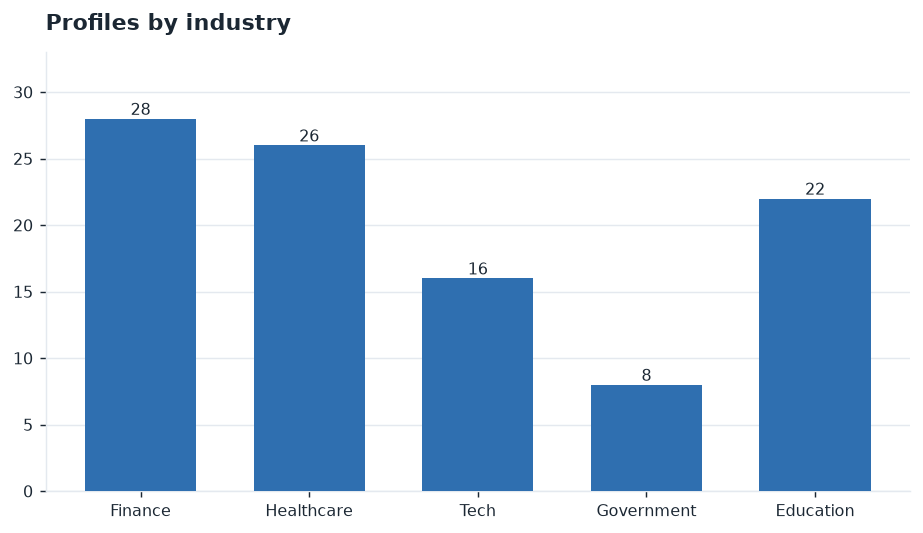
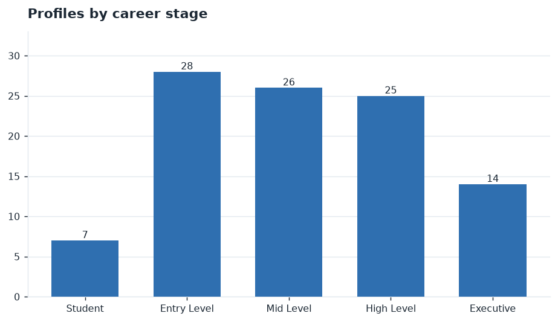
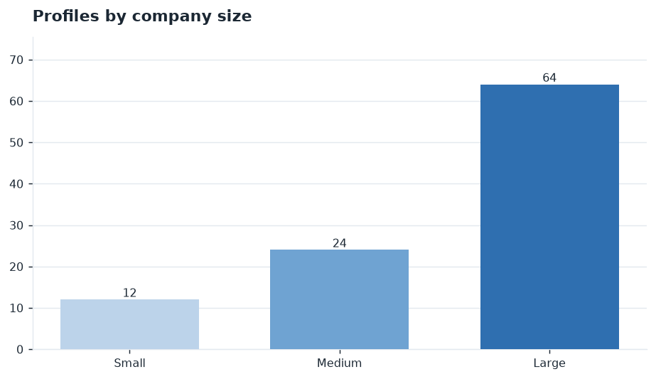
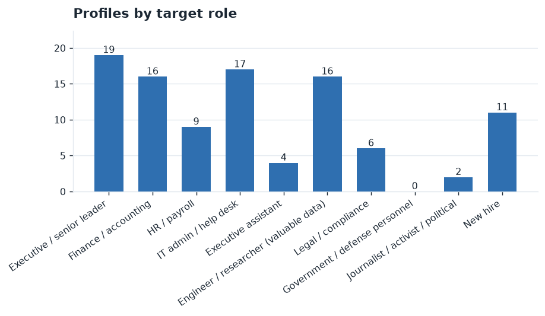
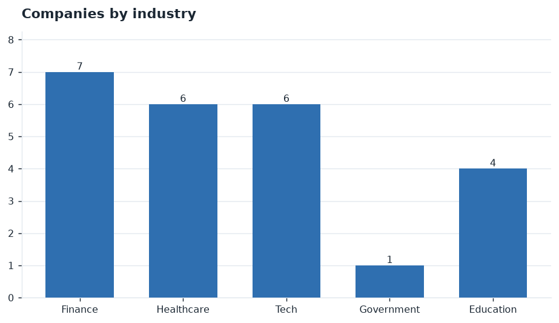
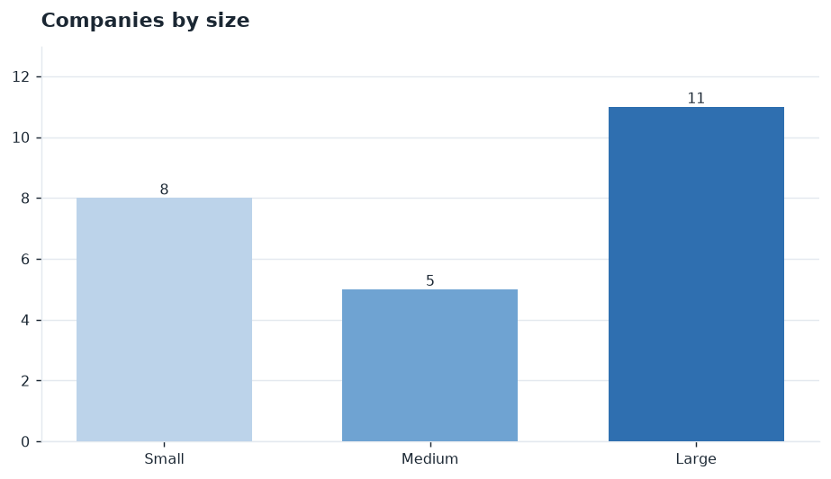
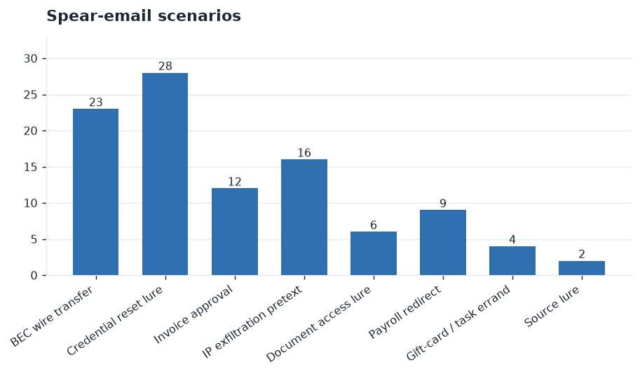
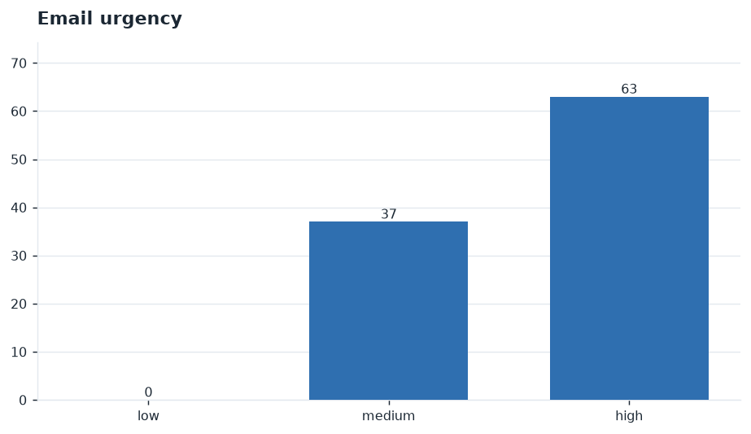
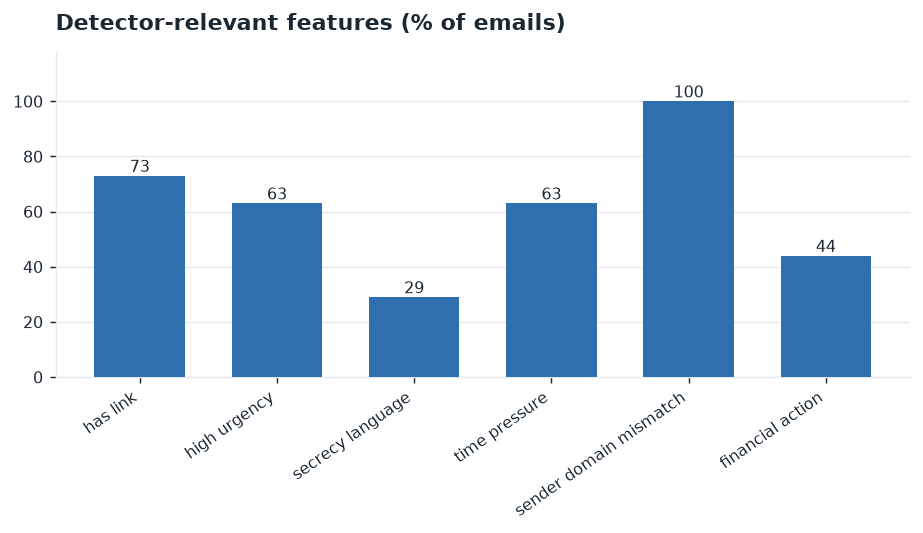
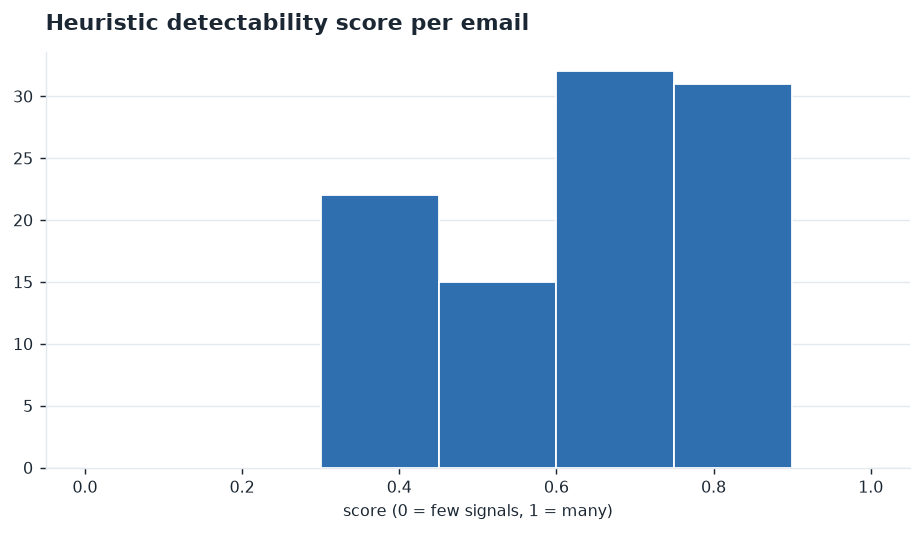

# Synthetic Spear-Phishing Corpus — Initial Run

_Generated 2026-10-24 · backend: **LocalBackend** · seed model: `claude-sonnet-5-5` · bulk model: `claude-haiku-5-5` · prompt v1 · random seed 7_

> All profiles, companies, and emails are **fictional**. Every email address and web domain is under a reserved `.example` zone. The corpus exists to train and evaluate a spear-phishing **detector**; nothing here is or can be sent.

## 1. Scope and method

This covers the profile-and-email **generator** only (the `Profiles.md` piece). Two LLM roles are used: one LLM invents synthetic people and companies, a second writes a spear email targeting each synthetic person.

**Two-stage, few-shot generation.** The first 5 profiles and 5 emails are written by the higher-capability model (`claude-sonnet-5-5`) with no exemplars and saved to `seeds/`. The remaining items are written by `claude-haiku-5-5` conditioned on those seeds as few-shot exemplars.

**MVP note.** This run was produced with the offline composing backend (`LocalBackend`): no API key was used (per the stated trajectory, the API call is the next step). The prompts, two-stage structure, schema, database, and analysis are the same ones the API path uses; switching the backend to `AnthropicBackend` makes the two passes real without other changes. In this run the full profile is given to the email generator (no context ablation yet).

**Record files** (one SQLite table each, linked by `profile_id` / `org_id`):

| file | records |
| --- | --- |
| orgs.jsonl | 24 |
| profiles_core.jsonl | 100 |
| profiles_public.jsonl | 100 |
| profiles_private.jsonl | 100 |
| profiles_behavior.jsonl | 100 |
| emails_attack.jsonl | 100 |

## 2. Who was generated

100 profiles across 24 synthetic companies.



*Profiles by industry*

| industry | count | share |
| --- | --- | --- |
| Finance | 28 | 28% |
| Healthcare | 26 | 26% |
| Tech | 16 | 16% |
| Government | 8 | 8% |
| Education | 22 | 22% |



*Profiles by career stage*

| career stage | count | share |
| --- | --- | --- |
| Student | 7 | 7% |
| Entry Level | 28 | 28% |
| Mid Level | 26 | 26% |
| High Level | 25 | 25% |
| Executive | 14 | 14% |



*Profiles by company size*

| company size | count | share |
| --- | --- | --- |
| Small | 12 | 12% |
| Medium | 24 | 24% |
| Large | 64 | 64% |



*Profiles by target role*

| target role | count | share |
| --- | --- | --- |
| Executive / senior leader | 19 | 19% |
| Finance / accounting | 16 | 16% |
| HR / payroll | 9 | 9% |
| IT admin / help desk | 17 | 17% |
| Executive assistant | 4 | 4% |
| Engineer / researcher (valuable data) | 16 | 16% |
| Legal / compliance | 6 | 6% |
| Government / defense personnel | 0 | 0% |
| Journalist / activist / political | 2 | 2% |
| New hire | 11 | 11% |

### Companies



*Companies by industry*



*Companies by size*

## 3. Example profiles

**Noah Abara** — Chief Operations Officer  
`noah.abara@everwelldiagnostics.example` · Healthcare · Executive · target role: _Executive / senior leader_ · Columbus, OH

- Resume: Chaired the leadership committee reviewing budget and headcount.; Set and owned the annual operating plan across 3 business units.; Sponsored a cost-reduction program that reset vendor contracts.
- Public footprint: high
- Private projects: the vendor-consolidation effort, the margin-recovery plan
- Sensitive access: approves budgets and large POs, broad system access, signs vendor contracts
- Behavior: security awareness high; traits: quick to click familiar links, eager to prove themselves, frequently traveling

**Oscar Rossi** — Systems Administrator  
`oscar.rossi@pinemarklabs.example` · Tech · Mid Level · target role: _IT admin / help desk_ · Austin, TX

- Resume: Resolved tier-2 incidents and managed the password-reset queue.; Maintained endpoint provisioning and VPN configuration.; Administered identity, SSO, and privileged-access tooling.
- Public footprint: medium
- Private projects: the SSO migration, the laptop refresh
- Sensitive access: resets passwords and MFA, holds privileged credentials, can grant system access
- Behavior: security awareness medium; traits: quick to click familiar links, skeptical of urgency, frequently traveling, trusting of internal requests

**Lucas Nakamura** — Junior Engineer  
`lucas.nakamura@everwellcaresystems.example` · Healthcare · Entry Level · target role: _Engineer / researcher (valuable data)_ · Richmond, VA

- Resume: Maintained the core service handling proprietary datasets.; Authored internal specs later filed as pending IP.; Led the sensor-fusion model workstream and owned its design docs.
- Public footprint: medium
- Private projects: the inference pipeline, the sensor-fusion model
- Sensitive access: accesses proprietary source and data, holds design documents, can export datasets
- Behavior: security awareness low; traits: responsive to authority, process-oriented, helpful to new colleagues

## 4. Example spear emails

**Scenario:** BEC wire transfer · **urgency:** high · impersonating _External Counsel_

- From: `External Counsel, Everwell Diagnostics <external@everwelldiagnostics-billing.example>`
- Subject: **Confidential — wire authorization**
- Personalization used: target_role, projects

```
Hi Noah,

External Counsel, Everwell Diagnostics here. We have a time-sensitive vendor payment that needs to go out before close today. I'm tied up in meetings and can't reach the bank line. Can you process a wire to the account below and confirm once done? Please keep this between us until the vendor-consolidation effort announcement.

Amount: $9,980
Reference: the vendor-consolidation effort

Thanks for the quick turnaround.
External Counsel, Everwell Diagnostics
Everwell Diagnostics
```

**Scenario:** Credential reset lure · **urgency:** high · impersonating _Security Operations_

- From: `Security Operations, Pinemark Labs <security@pinemarklabs-hr.example>`
- Subject: **Action required: privileged account review**
- Personalization used: target_role, projects

```
Hi Oscar,

Our records show your account on the Pinemark Labs portal needs re-verification after a policy change. To avoid a lockout, confirm your credentials within 24 hours:

https://pinemarklabs-hr.example/verify?u=oscar

Regards,
Security Operations, Pinemark Labs
```

**Scenario:** Invoice approval · **urgency:** high · impersonating _Finance Director_

- From: `Finance Director, Haskett Trust <finance@hasketttrust-it.example>`
- Subject: **Approval needed: the vendor-consolidation effort vendor PO**
- Personalization used: target_role, projects, project name

```
Hi Clara,

Following up on the outstanding invoice tied to the vendor-consolidation effort. The vendor is asking for approval today. Review and approve at the link so we don't slip the deadline:

https://hasketttrust-it.example/verify?u=clara

Appreciate it,
Finance Director, Haskett Trust
Haskett Trust
```

**Scenario:** IP exfiltration pretext · **urgency:** medium · impersonating _Partner Integrations_

- From: `Partner Integrations, Everwell Care Systems <partner@everwellcaresystems-inc.example>`
- Subject: **Shared workspace for the inference pipeline deliverables**
- Personalization used: target_role, projects, project name

```
Hi Lucas,

We're setting up the shared workspace for the inference pipeline deliverables. Please upload the latest design docs and dataset exports here so we can sync before the review:

https://everwellcaresystems-inc.example/verify?u=lucas

Thanks,
Partner Integrations, Everwell Care Systems
```

## 5. Email detectability pass

Each email is scored on features phishing detectors commonly key on, and the corpus is measured for template repetition. Figures and figures only; numbers are observations.



*Spear-email scenarios*



*Email urgency*



*Detector-relevant feature prevalence*



*Heuristic detectability score per email*

| metric | value |
| --- | --- |
| emails | 100 |
| mean heuristic detectability (0–1) | 0.634 |
| distinct email-body signatures | 50 / 100 |
| corpus type–token ratio | 0.0587 |

## 6. Observations

- The sampled target distribution is non-uniform by design (see §2): finance, tech, and executive/finance roles are over-represented relative to a flat prior, matching the weighting declared in `config/dimensions.py`.
- Sender-domain mismatch appears in 100% of emails — in this run it is universal because every sender address is a synthetic look-alike cousin of the company `.example` domain, so it is a trivially separable signal as generated.
- Body-template repetition is high: 50 distinct body signatures across 100 emails and a corpus type–token ratio of 0.0587. The MVP composing backend draws from a finite template pool, so the emails cluster into few lexical shapes — i.e. they are quickly identifiable by n-gram repetition, consistent with the stated hypothesis for this stub.
- These repetition and mismatch signals are properties of the offline backend. The next step in the stated trajectory (real `claude-haiku-5-5` generation, then selective context removal) is what tests whether LLM-written emails remain this separable; the same analysis code applies unchanged.

## Appendix — reproducing / switching to the API

```bash
# offline run (no key), as used here:
python scripts/run_initial.py --profiles 100 --emails 100 --seed 7

# real API run (Sonnet seeds + Haiku bulk): install the SDK and set credentials,
# then pass --backend anthropic
pip install anthropic
python scripts/run_initial.py --profiles 100 --emails 100 --backend anthropic
```
